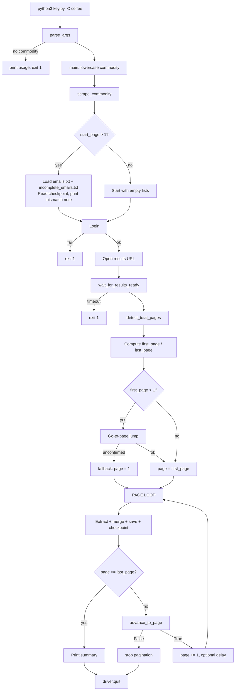
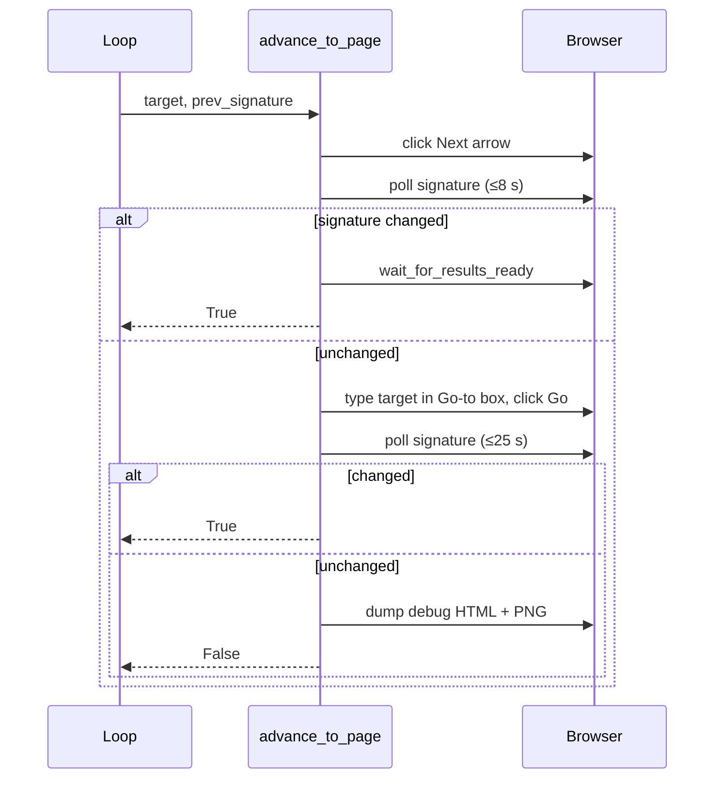
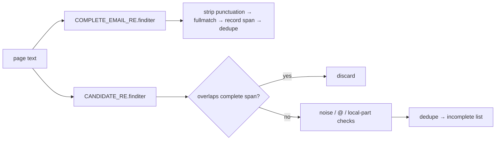

# Runtime Workflow

## 1. High-level flow



## 2. Step-by-step

### Step 0 — Start
`parse_args()` builds the parser. Missing commodity → prints usage and exits 1.

### Step 1 — Initialize state
Create the browser (`build_driver`), four empty collections, and (if `--start-page > 1`) load previous output.

### Step 2 — Login
Fill fields, click, wait for URL change or visible error. Failure → exit 1.

### Step 3 — Results page
`quote(commodity)` → URL → `driver.get` → `wait_for_results_ready`.

### Step 4 — Page range
```
total_pages = detect_total_pages()
first_page  = max(1, start_page or 1)
last_page   = min(total_pages, end_page or total_pages)
```
`first_page > last_page` → print message and return.

### Step 5 — Jump to start page (only if `first_page > 1`)
Capture signature → `go_to_page_via_input` → wait for change → `wait_for_results_ready`. On any failure, `current_page = 1`.

### Step 6 — Per-page loop

```
while page <= last_page:
    try:
        html  = driver.page_source
        text  = BeautifulSoup(html).get_text(" ", strip=True)
        complete, incomplete = extract_emails(text)
        merge new into run-wide lists (via lower-case seen sets)
        print "Page X/Y – found N new complete emails, M incomplete"
        write emails.txt, incomplete_emails.txt, checkpoint
    except Exception as e:
        print error, continue

    if page >= last_page: break
    sig = get_page_signature()
    ok  = advance_to_page(page + 1, sig)
    if not ok: print; break
    page += 1
    sleep(delay) if delay > 0
```

### Step 7 — Navigation sequence (`advance_to_page`)



### Step 8 — Finish
Summary line `Finished. Complete: X | Incomplete: Y | Total pages: Z`. `finally: driver.quit()`.

## 3. Extraction sub-workflow



## 4. Worked example

Text: `Contact sales@acme.com, or jane@ for rates. ops@acme`

| Stage | Result |
|---|---|
| Complete regex | `sales@acme.com,` → stripped to `sales@acme.com` |
| Candidate regex | `sales@acme.com` (overlap → dropped), `jane@` (kept), `ops@acme` (kept) |
| Output | complete: `[sales@acme.com]`, incomplete: `[jane@, ops@acme]` |

## 5. Resume workflow

```
Run 1: python3 key.py -C coffee            # crashes after page 37
       last_successful_page.txt = 37
Run 2: python3 key.py -C coffee --start-page 38
       → loads existing files → jumps to 38 → continues → rewrites merged files
```

If the jump to 38 fails, the script **starts from page 1** instead. Watch the first `Page N/…` log line.

## 6. Exit conditions

| Condition | Exit |
|---|---|
| No commodity | code 1 |
| Missing credentials | code 1 |
| Login failed | code 1 |
| Results timeout | code 1 |
| `start > end` | returns normally (nothing done) |
| Navigation failure mid-run | loop breaks; normal finish message |
| Last page processed | normal finish |
